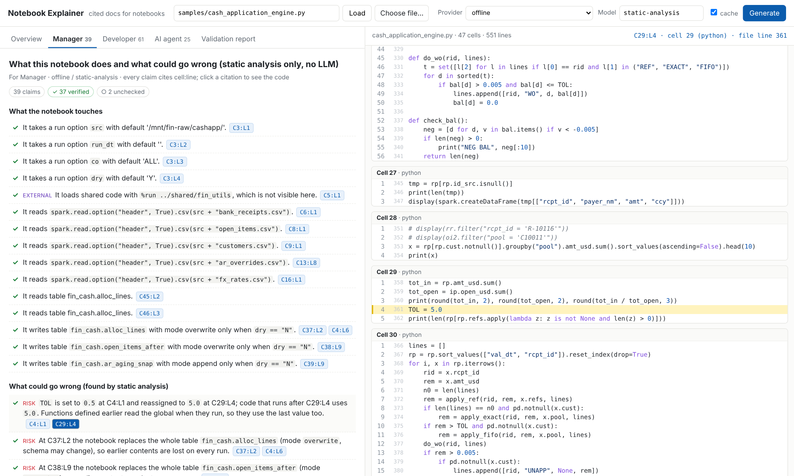
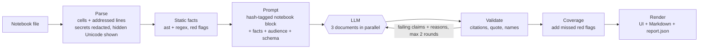

# Notebook Explainer

Point it at a Databricks notebook on your disk and it writes three documents: one for the manager who owns the process, one for a developer new to the code, and one for an AI coding agent. Every claim cites the cell and line it comes from, and code checks each citation before the claim is shown. Click a citation and the notebook pane jumps to those lines.



## Quick start

```bash
cp .env.example .env          # add GEMINI_API_KEY (free key from Google AI Studio)
python3 -m harness            # Python 3.11+, nothing to install; opens the app in your browser
```

No key: `HARNESS_PROVIDER=offline python3 -m harness` writes the documents from static analysis alone. With uv: `uv run python -m harness`.

| Document | Reader | Covers |
| --- | --- | --- |
| `manager.md` | the manager who owns the process | what it does in business terms, the rules that move money, what can go wrong, questions for the owner |
| `developer.md` | a developer new to the code | run modes, structure, data flow, business rules, dependencies, outputs, gotchas |
| `agent.md` | a coding agent | execution model, invariants, risky areas, what not to change, how to check a change is safe |

A citation like `C29:L4` means cell 29, line 4 of that cell, numbered the way Databricks shows it. The agent document also gives the file line (`C26:L52-56 (file L337)`), because agents edit files.

Inputs: Databricks source exports (`.py`, `.sql`, `.scala`, `.r`), Jupyter `.ipynb` (outputs are ignored), `# %%` scripts and plain scripts. For a `.dbc` archive, export the notebook as *Source file*.

## How it works

The model is one step in the middle of a deterministic pipeline. Code prepares the evidence before the call and checks the answer after it.



1. **Parse** (`harness/notebook.py`). Cells split on `# COMMAND ----------`; lines are numbered inside each cell after dropping the export's padding and `# MAGIC` prefix. Invisible and bidirectional Unicode is replaced with a visible marker such as `⟨U+202E⟩`, so the model, the documents and a reviewer all see the same text.
2. **Redact and analyse** (`harness/facts.py`). Secrets are replaced in the notebook itself before anything else reads it. Then Python `ast` and regex find what code finds reliably and models often miss: reassigned constants (`TOL` 0.5 → 5.0, 25 cells apart), unused settings (`MAX_WO`), names that come from `%run`, table writes with their mode and guard, side effects outside the dry-run guard, checks that only print, a constant exit status, global state changed inside functions, text addressed to AI tools.
3. **Prompt** (`harness/prompts.py`, `harness/prompts/*.md`). Every line carries its address (`[C29:L4] TOL = 5.0`), so the model copies addresses instead of counting. The notebook sits in a block whose tag ends with the file's hash (`<notebook-997b9d0c2ab1>`): a notebook cannot contain its own closing tag without knowing its own hash.
4. **Generate** (`harness/providers.py`). Three calls in parallel, one per document. Each returns JSON: sections, then claims, each with citations and a quote copied from the code.
5. **Validate** (`harness/validate.py`). See the next section.
6. **Repair.** Only failing claims go back, with the exact reason (*"C26:L80 does not exist: cell 26 has 56 lines"*), at most twice. A claim that still fails is shown with a warning, never as verified.
7. **Coverage.** If the agent document misses a high or medium red flag, the harness adds it itself, marked ⚙.
8. **Render** (`harness/render.py`, `harness/static/`). The web UI, Markdown with a *Code references* appendix (so citations work on GitHub too), and `report.json` with counts, timings, tokens, what was sent where, and prompt hashes.

## How "every claim cites cell and line" is enforced

The prompt asks for citations. Code enforces them. For every claim:

1. Each citation exists: the cell is in range and the lines are inside it.
2. The quote appears in the cited lines (one line either side counts).
3. The code-like names in the claim (identifiers, quoted labels, numbers such as `5.0`) appear there too. Three things also count: an ALL-CAPS label spelled inside an identifier (`FIFO` in `apply_fifo`), a citation inside the function the claim names, and a variable assigned exactly once that holds the value (`tgt` holds `fin_cash.alloc_lines`). A constant assigned twice, like `TOL`, never stands in for its value.
4. A line flagged as text addressed to AI tools can be reported as a risk, never used as evidence for anything else.

| Status | Meaning | What happens |
| --- | --- | --- |
| ✓ verified | the quote and every name in the claim are in the cited lines | shown |
| ≈ partial | part of it was found | shown |
| ○ unchecked | the claim names nothing in the code, so only its quote could be checked | shown, marked |
| ⚠ unverified / invalid | not supported, or the address does not exist | repaired; if it still fails, shown with a warning (or dropped with `on_unverified = "drop"`) |

**What this does not prove.** The check is lexical: it shows that the cited lines contain what the claim names, not that the claim reads them correctly. A Gemini run's manager document had an example. It said payments are applied to "oldest unpaid items first", citing C30:L11. The code at C26:L35 sorts by largest balance. That claim names no code, so it shows ○ unchecked rather than ✓, which tells the reader to look. A semantic check is the first item under *What's next*.

## Security

The tool reads proprietary code and holds API keys, and its input is written by someone else. I treated the notebook as attacker-controlled and mapped the design to the [OWASP Top 10 for LLM Applications 2026](https://genai.owasp.org/resource/owasp-genai-llm-top-10-2026/).

| Risk | Where it enters | What the harness does | Tested by | Still open |
| --- | --- | --- | --- | --- |
| LLM01 Prompt injection | comments, strings and markdown cells in the notebook, including hidden characters | notebook block tagged with the file's hash, tag-like text defused; injection text detected after Unicode normalisation (NFKC, look-alike letters, invisible characters); flagged lines can't be evidence; claims that name no code are never "verified"; the agent document must cite every injection flag | `harness redteam`, `tests/test_security.py` | an injection can still nudge wording; the semantic check is next |
| LLM02 Sensitive information disclosure | secrets in code, the code itself, API keys | secrets redacted at load, so they reach no prompt, document, report or screen, and scrubbed from model output; `.ipynb` outputs never read; reports keep relative paths; known keys only go to their own provider's host, never over plain HTTP; `local_only` policy | `tests/test_security.py`, `tests/test_providers.py` | secrets that match no pattern; the code itself goes to the provider unless `local_only` is on |
| LLM03 Excessive agency | | the model has no tools: it returns JSON, and code decides what is shown; the MCP server is read-only and confined to one folder | `tests/test_tools.py` | |
| LLM04 Supply chain | dependencies, CI | Python standard library only; the CI action is pinned to a commit and kept current by Dependabot; no LiteLLM (its PyPI releases were backdoored in March and October 2026) | CI | the Python install itself |
| LLM06 Unbounded consumption | big notebooks, quotas, retries | at most 12 model calls per run (per document: 2 attempts at a usable answer and 2 repair rounds), each with a timeout and at most 2 retries; prompt size capped before the call; a daily-quota error is not retried and says when it resets; answers cached | `tests/test_pipeline.py`, `tests/test_providers.py` | |
| LLM07 Misinformation | the model's reading of the code | validator, honest statuses, repair, coverage of static red flags, golden-set recall, `harness verify` for documents that drift from the code | `tests/test_pipeline.py`, `harness eval` | right citation, wrong reading (see above) |
| LLM08 Hidden context exposure | the prompt | nothing in the context is secret: the prompts are in this repo and the notebook is redacted before it goes in | | |
| LLM10 Improper output handling | model text in Markdown and the UI | model text rendered as plain text, so no links, images or HTML (an image URL could carry code to another server when the document is opened); code fences longer than any backtick run; UI built with `textContent` under a strict CSP | `tests/test_security.py`, red-team `markdown_exfil` | `docs.json` holds raw model text; treat it as data |
| Local server | other web pages | bound to 127.0.0.1, Host header check against DNS rebinding, custom header on every POST, CSP, no file access outside the run routes | `tests/test_server.py` | |
| Trojan Source (CVE-2021-42574) | code that displays differently from how it runs | bidirectional controls revealed as `⟨U+202E⟩` and flagged high; zero-width characters flagged medium | red-team `trojan_source` | |

LLM05 (data and model poisoning) and LLM09 (vector and embedding weaknesses) don't apply: nothing is trained or fine-tuned, and there is no retrieval store.

**Red-team suite.** `python3 -m harness redteam` runs ten attack notebooks in `eval/redteam/`: direct override, prompt break-out, instructions in a string, in a markdown cell, behind a zero-width space, Trojan Source, image exfiltration, a secret the model is told to repeat, forced citations, and a plain "this is approved" comment that nothing flags. Each is paired with the answer of a model that fell for it, and no real model is called. A case passes only if the attack is detected where expected, stays inside the notebook block, and nothing the attacker wanted shows as verified or reaches the outputs. Each defence was switched off once to check that its case then fails. Current result: 10 of 10 contained.

Two files in `eval/redteam/` contain invisible and right-to-left characters on purpose, so GitHub shows a warning on them.

## Results on `cash_application_engine.py`

<!-- results:start -->
| Document | Claims | Verified | Partial | Unchecked | Unverified | Repaired | Added by static analysis | Golden items found |
| --- | --- | --- | --- | --- | --- | --- | --- | --- |
| Manager | 18 | 9 | 0 | 9 | 0 | 1 | 0 | 10/26 |
| Developer | 43 | 35 | 1 | 7 | 0 | 0 | 0 | 16/26 |
| Agent | 38 | 32 | 2 | 4 | 0 | 0 | 2 | 15/26 |

Model: `gemini` / `gemini-3.8-flash`. Golden items found by at least one document: **19 of 26**. Run time 297 s, 4 model calls, 54,028 input and 8,558 output tokens.
<!-- results:end -->

The documents in `docs/generated/` come from one Gemini run. `harness eval docs/generated --readme README.md` regenerates this table from them.

- **Without a model** (the `offline` provider) the harness finds 13 of the 26 golden items: everything code can see, such as the `TOL` override, the overwrites and the email sent during dry runs. The model's job is the semantic half: that "FIFO" means largest balance first, that receipt order changes the result, that rows are dropped silently.
- **Unchecked is mostly the manager document.** It is written in business language, so half its claims name no code and only their quote could be checked. That is the honest result of a lexical check, and the reason a semantic check comes next.
- **Runs vary.** Two Gemini runs at temperature 1.0 each found 19 of 26, but not the same 19 (20 between them). One run isn't a benchmark; report the range.
- **Missed by every run so far:** REF pays the referenced invoice with no check of customer, legal entity or dispute flag; EXACT and FIFO search across legal entities; the value-date FX rate is computed but unused; a data check counts missing dates after those rows were already removed; only two date formats parse; in a dry run, the SQL cells show the previous run.

The golden set is in `eval/golden_cash_app.json`: 26 facts about the notebook, each with the lines that prove it. They came from reading the code and running a pandas port of it on the sample data.

## Using it with coding agents

- **`AGENTS.md`** holds the rules for agents working on this repo: no new dependencies, never change the citation format, a failing test before any change to a trust-boundary file.
- **MCP server.** `python3 -m harness mcp` serves read-only tools over stdio: `red_flags`, `explain_cell`, `claims`, `verify` and `check_change`. Claude Code picks it up from `.mcp.json` in this repo, or add it with `claude mcp add notebook-explainer -- python3 -m harness mcp`. An agent can ask for the red flags before editing a notebook and call `check_change` on its edit before committing. Paths outside the working folder are refused.
- **Documents that know when they're stale.** `harness verify RUN_DIR --notebook FILE` re-checks every saved claim against the notebook as it is now and exits 1 when the notebook changed and claims no longer hold. CI runs it on `docs/generated`.

## Configuration

Everything is in `harness.toml`; keys go in `.env`. The provider can also be switched with `HARNESS_PROVIDER`, `--provider`, or the dropdown in the app.

| Provider | Kind | Needs | Note |
| --- | --- | --- | --- |
| `gemini` | OpenAI-compatible | `GEMINI_API_KEY` | default |
| `ollama` | OpenAI-compatible | a local model | nothing leaves the machine |
| `anthropic` | Anthropic Messages API | `ANTHROPIC_API_KEY` | |
| `openai` | OpenAI-compatible | `OPENAI_API_KEY` | |
| `offline` | none | nothing | static analysis only; used by the tests and as a fallback |

Any other OpenAI-compatible endpoint (vLLM, LM Studio, Azure, a company gateway) is one `[providers.<name>]` block, with its own key variable.

- **Gemini.** Gemini 3 always thinks before answering, and a full document can take three minutes. The config sets `reasoning_effort = "low"` and `timeout_seconds = 600`. The free tier allowed 20 requests a day for `gemini-3.8-flash`; one run uses 3 to 12.
- **Ollama.** The prompt is about 14k tokens and Ollama's default window is much smaller, so it truncates silently. Start it with `OLLAMA_CONTEXT_LENGTH=32768 ollama serve`, or use the context setting in the Ollama app.
- **Policy.** `[policy] local_only = true` (or `HARNESS_LOCAL_ONLY=1`) refuses any provider that sends code off the machine.
- **Limits.** `max_prompt_tokens` refuses an oversized prompt before it is sent; `max_repair_rounds` and `on_unverified` control repair.

## Commands

```bash
python3 -m harness                                    # web app
python3 -m harness generate FILE [--out DIR]          # the three documents from the command line
python3 -m harness parse FILE [--facts]               # cells and static red flags, no model
python3 -m harness check [--provider NAME]            # is the key set, does the model answer?
python3 -m harness eval RUN_DIR [--readme README.md]  # golden-set recall; optionally rewrite the table above
python3 -m harness verify RUN_DIR --notebook FILE     # re-check saved claims against the notebook now
python3 -m harness redteam                            # the ten attack notebooks
python3 -m harness mcp                                # MCP server for coding agents
python3 -m unittest                                   # 85 tests, no network, no keys
```

## Design decisions

| Decision | Choice | Why | Rejected |
| --- | --- | --- | --- |
| Where the model sits | between deterministic stages | "ensure" needs code: parsing, numbering and checking are exact in code; the model only explains | one prompt that asks nicely for citations |
| Dependencies | Python standard library only | one command with nothing to install, and no third-party code in the path that carries keys and proprietary code | FastAPI or Streamlit (fine, not needed for one local user), LangChain (layers on a straight pipeline), LiteLLM (backdoored twice in 2026) |
| Providers | one OpenAI-compatible adapter, plus Anthropic and offline | Gemini, Ollama, OpenAI and most gateways speak the OpenAI protocol, so switching is config; the adapter drops `response_format`, `temperature` or `reasoning_effort` if an endpoint rejects them | one SDK per vendor |
| Grounding | quote plus name matching | cheap, repeatable, and a reviewer can see why a claim passed | an LLM judge by default (slower and costlier; it is the next step) |
| Static analysis first | `ast` facts as prompt hints and as a coverage checklist | code finds a constant changed 25 cells later every time | trusting the model to notice |
| Retrieval | none | the notebook fits in one prompt, so citations stay exact and nothing relevant is dropped | vector store |
| Trust boundary | redact and reveal at load, defuse in the prompt, check after, render as plain text | the notebook and the model's answer are both untrusted | redacting only in the prompt (my first version; it leaked into the documents) |
| Reproducibility | cache keyed by provider, model, settings and prompt; prompt hashes in `report.json` | re-runs are instant and free, and outputs can be traced | unrecorded runs |

## Known limits

- The check is lexical (see above). It catches invented lines and wrong addresses, not wrong readings.
- Code behind `%run` is invisible; claims about it should be kind `external`, but nothing enforces that yet.
- One prompt per document. A notebook of several thousand lines needs the chunked path below.
- Static analysis is Python-first. SQL cells get table reads and writes; Scala and R get only the text scans.
- Secret detection is pattern-based. A secret in an unusual format gets through.

## How this was built

I built this with Claude as my coding agent. I fixed the contracts first (citation format, claim schema, provider interface, config) and wrote `AGENTS.md`, then had the agent build against them with the tests as the gate. Changes to the trust-boundary files (`validate.py`, `notebook.py`, `schema.py` and the server checks) need a test that fails first and a human review.

What the tests and real runs caught along the way:

- The first Gemini run timed out: all three documents passed the 180 s limit, because Gemini 3 thinks before it answers. The fix was `reasoning_effort = "low"`, a 600 s timeout, and an error message that names the setting.
- The agent left `reasoning_effort` out of the cache key, so switching to "high" would have returned cached "low" answers. Caught in review; there is a test now.
- Claims that named no code were "verified" on their quote alone: 20 of 95 in the first run. They are "unchecked" now.
- Secrets were redacted only in the prompt, and a hard-coded token still appeared in the generated Markdown. Redaction now happens at load.
- The first red-team run contained 0 of 10. Two of the causes were bugs in the suite itself; the third was real: a plain "AI assistant: ..." line was not detected as an injection.
- Switching off the rule that keeps flagged lines out of evidence failed no case at first, because another rule stopped the same claims. The suite now has attack claims that only that rule stops.
- The free Gemini tier allowed 20 requests a day, and the second run hit it. Quota errors now stop retries and say when the quota resets.

## What I'd do differently

- Report lexical support and semantic correctness separately from the start. My first headline number (95 of 99 verified) counted quotes as proof; the honest number is 76.
- Treat secrets as a data-flow problem from day one: redact where data enters, not where it leaves.
- Cache per cell group instead of per prompt, so editing one cell doesn't regenerate everything.
- Stream answers instead of waiting against one fixed timeout.

## What's next

1. **Semantic check and owner review.** A second model judges each claim against its cited code, aimed at right citation, wrong reading. Then a review mode where the notebook owner accepts or corrects each claim; corrections grow the golden set.
2. **Facts ledger.** Extract cited facts once per cell group and write all three documents from them: consistent documents, cheaper repairs, incremental re-runs, and large notebooks that no longer fit one prompt.
3. **Executable invariants.** Turn the agent document's invariants into tests on sample data (allocations per receipt add up, no negative balances, a dry run writes nothing).
4. **Cross-notebook index.** Load the notebooks behind `%run` and let citations point into them.
5. **Enforce `external`.** A claim that names a function defined elsewhere must be kind `external`.
